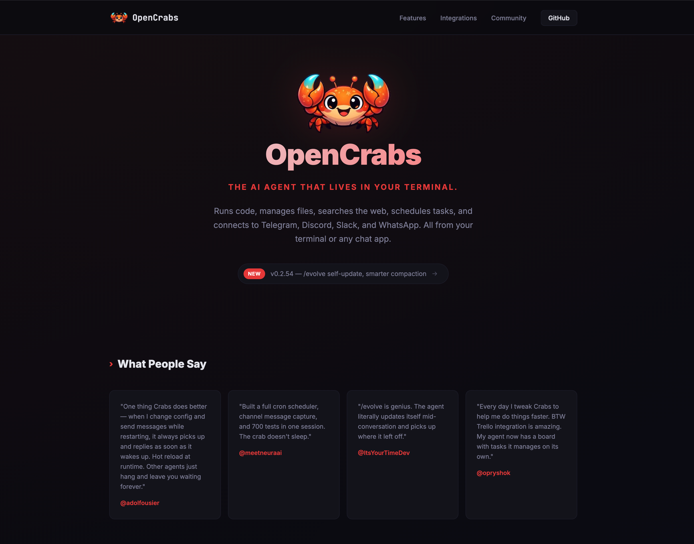

# Crabsland

Landing page for [OpenCrabs](https://github.com/adolfousier/opencrabs) — the AI agent that lives in your terminal.

Built with [Leptos](https://leptos.dev/) (Rust) and served via [Trunk](https://trunkrs.dev/).

## Prerequisites

- Rust (1.85+ for edition 2024)
- WASM target: `rustup target add wasm32-unknown-unknown`
- Trunk: `cargo install trunk`

## Development

```bash
trunk serve --open
```

This starts a local dev server with hot reload at `http://127.0.0.1:8080`.

## Build

```bash
trunk build --release
```

Output goes to the `dist/` directory.

## Documentation Site

The `docs/` directory contains an [mdBook](https://rust-lang.github.io/mdBook/) documentation site served at [docs.opencrabs.com](https://docs.opencrabs.com).

```bash
# Preview locally with live reload
cd docs && mdbook serve
# Opens at http://localhost:3000

# Or just build
cd docs && mdbook build
# Open docs/book/index.html in your browser
```

Install mdBook: `cargo install mdbook`

For the whole site (English plus the pt-PT, es, fr, ru and id translations) and
the per-page Open Graph previews, use the wrapper:

```bash
cd docs && ./build-all.sh
```

It runs mdbook for every locale that has a translation, then renders a 1200x630
preview of each page with headless Chrome and rewrites that page's og:*/twitter
tags to point at its own preview. Set `SKIP_OG=1` to skip the previews.

## Deploy

Production is the `opencrabs/landing:latest` image on Docker Hub, running on the
`neuraprodnew` host as the `opencrabs-landing` container on port 19283, driven by
`src/docker/docker-compose.yml`.

One command does the whole release:

```bash
scripts/deploy.sh              # build the image, push it, roll the server
scripts/deploy.sh --docs       # rebuild the docs book first
scripts/deploy.sh --skip-build # roll the server onto the published image
scripts/deploy.sh --dry-run    # print the steps, change nothing
```

The script logs in to Docker Hub with `DOCKER_LOGIN_TOKEN` from `.env`, builds
and pushes the `linux/amd64` image, then over ssh pulls it on `neuraprodnew`,
recreates the container and checks the live site plus a docs preview.

The docs ship inside the image (`docs/book` is copied into nginx), so rebuild
them locally before deploying when they changed. `og_previews.py` needs macOS
Chrome and `sips`, so it runs on this machine only, never in the image build.

## Stack

- **Leptos 0.8** — Rust reactive UI framework (CSR mode)
- **Trunk** — WASM build tool and dev server
- **CSS** — Custom styles, no framework dependencies

## Screenshot



## License

MIT
